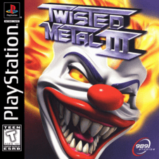

  

<h1 align="center">TwistedMetal3-xport</h1>

  Twisted Metal 3 (PSX) decompilation port via Codex

  <!-- <a href="https://psxports.to/TM3/"><strong>Play Game</strong></a> -->

## Project Status

| Stage | Progress |
| ---: | :---: |
| **decomp:** |  |
| **refactor:** |  |
| **enhance:** |  |
| **remaster:** |  |

